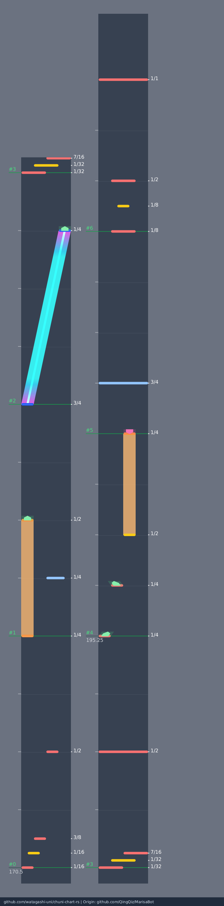
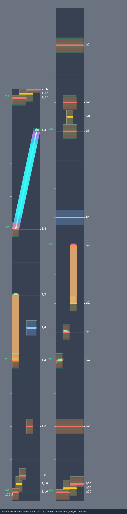

# chuni-chart-rs

CHUNITHM C2S 谱面预览图生成服务，用 Rust 重写自 [MarisaBot / Marisa.Frontend](https://github.com/QingQiz/MarisaBot) 的谱面预览。

原项目用 Vue 页面绘制谱面，再由无头浏览器截图；本项目直接在 CPU 上光栅化，输出 PNG / JPEG，画面风格与原项目保持一致。

| 普通预览 | 判定范围（`/judge`） |
| --- | --- |
|  |  |

示例图由自制谱面 `tests/fixtures/demo.c2s` 生成。

## 特点

- **不需要浏览器**：单个二进制文件，字体已内嵌，Linux / Windows 开箱即用。
- **速度快**：一张 MASTER 谱面图通常约 0.5 秒，比原项目“页面生成 + 浏览器截图”快约 2 倍，见下方[性能对比](#性能对比)。
- **三种出图模式**：普通预览、判定范围图，以及只显示提前 ATTACK 的 fastattack 图。
- **谱面兼容**：支持小数 BPM、变速（SFL / SLP / SLA）、新旧 SLIDE 样式、超界音符等。
- **适合给 Bot 调用**：HTTP 接口直接返回图片，支持 ETag / 304 缓存，可配置并发数和排队。
- **有资源限制**：每张图在独立子进程中渲染，限制内存、CPU 时间和图片尺寸，谱面异常不会拖垮服务。

## 使用方式

### 1. 下载并启动

从 [Releases](https://github.com/watagashi-uni/chuni-chart-rs/releases) 下载 Linux x64 或 Windows x64 包，解压后：

```sh
./chuni-chart-rs init-config          # 生成 config.json
# 编辑 config.json，把 chart_dir 改成存放 .c2s 文件的目录
./chuni-chart-rs serve
```

Windows 下把 `./chuni-chart-rs` 换成 `.\chuni-chart-rs.exe` 即可。访问 `http://127.0.0.1:3000/healthz` 返回 `ok` 说明服务已启动。

### 2. 配置

```json
{
  "chart_dir": "charts",
  "listen": "127.0.0.1:3000",
  "timeout_seconds": 15,
  "render_workers": 4,
  "queue_capacity": 32,
  "queue_timeout_seconds": 30,
  "etag_salt": null
}
```

| 配置 | 说明 |
| --- | --- |
| `chart_dir` | 谱面目录，直接放 `1086_03.c2s` 这样的文件，不搜索子目录 |
| `listen` | 监听地址，默认只监听本机 |
| `render_workers` | 同时渲染的图片数，默认 4 |
| `queue_capacity` | 忙时最多排队的请求数，默认 32 |
| `queue_timeout_seconds` | 排队超时，默认 30 秒 |
| `timeout_seconds` | 单张图渲染超时，默认 15 秒 |
| `etag_salt` | ETag 签名用的随机盐，`init-config` 会自动生成，不要泄露 |

### 3. 获取图片

```text
GET /api/render/1086_03                 普通预览（PNG）
GET /api/render/1086_03?format=jpg      JPEG
GET /judge?name=1086_03                 判定范围图
GET /fastattack/1086_03                 只显示提前 ATTACK
GET /api/render/1086_03?column=3        只看第 3 列
```

常用参数：

| 参数 | 说明 |
| --- | --- |
| `format` | `png`（默认）或 `jpg` |
| `judge` | `1` 显示判定范围 |
| `fastattack` | `1` 只显示仍有提前 ATTACK 的音符的判定范围 |
| `div` | `0` 隐藏音符旁的 `1/16` 等分度标注 |
| `easy` | `1` 使用 BASIC / ADVANCED 判定窗口 |
| `column` | 只输出某一列（从 1 开始） |
| `zoom` | 纵向缩放，0.5–2 |

返回码：`404` 谱面不存在，`400` 参数错误，`422` 谱面无法解析或超出限制，`429` 队列已满（稍后重试）。

响应带 `ETag`，客户端下次请求时带上 `If-None-Match`，谱面没变就返回 `304`，不会重新渲染。Chunibot 可将 `CHUNIBOT_CHART_PNG_URL` 指向 `/api/render` 并开启 `CHUNIBOT_CHART_ETAG_ENABLED=1`。

### 4. 命令行出图

```sh
chuni-chart-rs render 1086_03.c2s -o chart.png
chuni-chart-rs render 1086_03.c2s --judge -o judge.jpg
chuni-chart-rs render 1086_03.c2s --early-attack-only -o fastattack.png
chuni-chart-rs inspect 1086_03.c2s > timing.json   # 输出解析和判定数据
```

### Linux 部署

仓库附带 systemd 配置 [deploy/chuni-chart.service](deploy/chuni-chart.service)，默认只监听本机，外网访问请通过反向代理。安全边界与资源限制见 [SECURITY.md](SECURITY.md)。

## 开发

需要 Rust（edition 2024）和 Python 3。

```sh
git clone https://github.com/watagashi-uni/chuni-chart-rs.git
cd chuni-chart-rs
cargo build --release --locked
cargo run --release -- render tests/fixtures/demo.c2s -o demo.png
```

提交前运行检查：

```sh
cargo fmt --all -- --check
cargo clippy --all-targets --locked -- -D warnings
cargo test --locked
python3 scripts/smoke.py           # 以及 security_http.py / queue_http.py / access_log.py
```

代码结构：

| 文件 | 内容 |
| --- | --- |
| `src/chart.rs` | C2S 解析与时间轴 |
| `src/layout.rs` | 分列与排版 |
| `src/render.rs` | 光栅化与 PNG / JPEG 编码 |
| `src/judgement.rs` | 判定窗口与相邻音符保护 |
| `src/service.rs` / `src/queue.rs` | HTTP 服务与排队 |

出图与判定的具体规则见 [docs/rendering-and-judgement.md](docs/rendering-and-judgement.md)。

## 性能对比

随机抽取 30 张 MASTER 谱面，每张跑 3 次取中位数，单位为毫秒：

| 阶段 | 原项目（中位数 / 最慢） | 本项目（中位数 / 最慢） |
| --- | --- | --- |
| 生成 HTML：加载页面、解析谱面、Vue 生成 DOM | 709 / 3456 | — |
| 浏览器渲染：排版、绘制、截图为 JPEG | 390 / 640 | — |
| **合计** | **1050 / 4111** | **482 / 825**（PNG）<br>**463 / 682**（JPEG） |

- 本项目时间是一次完整命令行出图，包含进程启动、解析、绘制和编码。
- 原项目按 MarisaBot 的方式运行：浏览器常驻，每张图开一个新页面，整页截图为 JPEG（质量 90），不含浏览器启动时间。
- 原项目实际调用时还会等待网络空闲（`networkidle0`），这部分等待让合计中位数变为 2402 ms，最慢 8128 ms。
- 两边输出的图片宽度一致，本项目底部多一行署名。谱面越长、元素越多，原项目的 DOM 生成越慢，差距越大（最多约 5 倍）。

测试环境：AMD EPYC 7B13，Chromium 156，Node.js 20；原项目为 MarisaBot 当前 `Marisa.Frontend` 的生产构建。测试脚本为 [scripts/bench-marisa.mjs](scripts/bench-marisa.mjs)，准备步骤写在脚本开头。

## License

AGPL-3.0-only。原项目和参考来源见 [NOTICE](NOTICE)，字体许可见 [assets/FONT-LICENSE](assets/FONT-LICENSE)。
